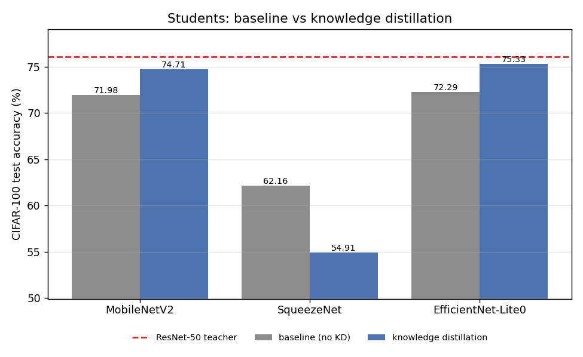
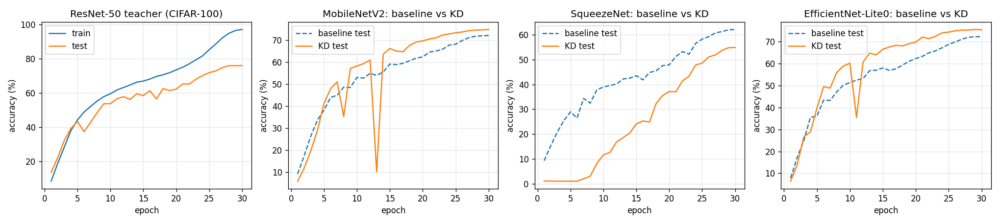
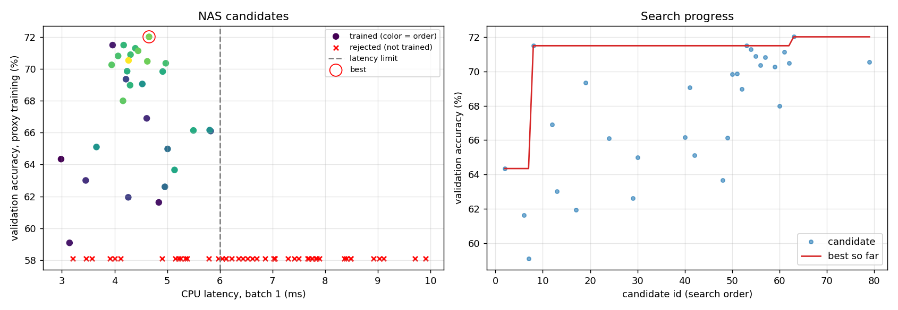
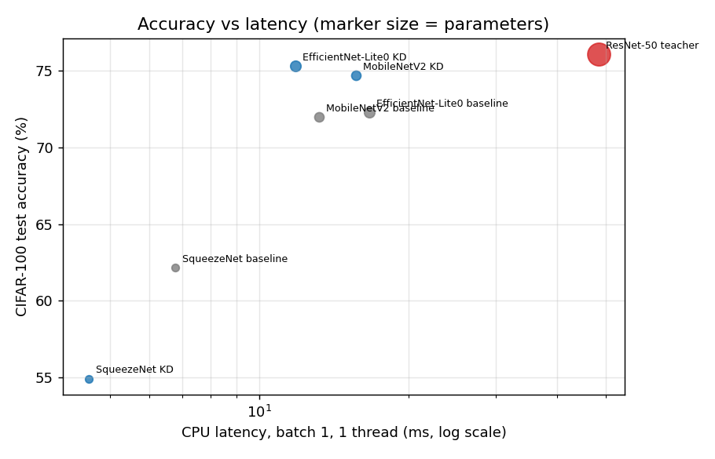
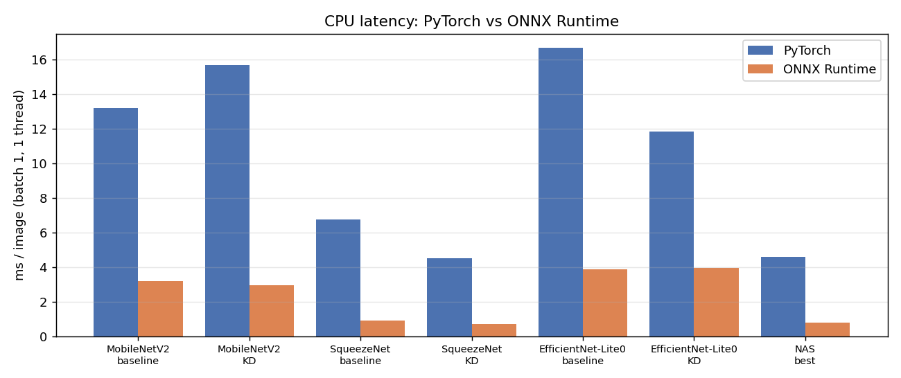

# Assignment 4 - Edge Computing & Intelligent Systems

## Knowledge Distillation (CIFAR-100) and Hardware-Aware Neural Architecture Search (CIFAR-10)

Name: Syed M. Alyun  Roll No: 23I-0022  Section: AI-A7  

## 1. Environment

- Python 3.13.16, PyTorch 2.14.1+cu130, OS: Linux x86_64
- Training device: CUDA GPU (mixed precision FP16)
- Benchmark CPU: Intel(R) Xeon(R) CPU @ 2.00GHz, latency measured with 1 thread(s), batch 1
- Data pipeline: the whole uint8 dataset is kept on the GPU; random crop (4-pixel padding) + horizontal flip and normalisation are done on the GPU per batch (much faster than a CPU DataLoader for 32x32 images).
- Model selection: every training run uses a fixed schedule and keeps the final weights. No checkpoint is chosen using the test set; the NAS uses a validation split carved out of the training set.

# Question 1 - Knowledge distillation

## 2. Teacher: ResNet-50 - `src/resnet50.py`, `src/train_teacher.py`

Bottleneck ResNet-50 ([3, 4, 6, 3] blocks, 23.7 M parameters) adapted to 32x32 images: 3x3 stride-1 stem and no max-pool. Trained from scratch on CIFAR-100: SGD (momentum 0.9, Nesterov, weight decay 5e-4), One-Cycle LR (max 0.1), batch 128, mixed precision.

Result: **76.08%** test accuracy after 30 epochs.

## 3. Student architectures - `src/mobilenetv2.py`, `src/squeezenet.py`, `src/efficientnet_lite.py`

All three are implemented from scratch (no torchvision models) and adapted to 32x32 input by removing early down-sampling, so every network ends with a 4x4 feature map.

| Student | Key building block | CIFAR adaptation | Feature maps used for KD |
|---|---|---|---|
| MobileNetV2 | inverted residual: 1x1 expand -> 3x3 depthwise -> 1x1 linear projection, ReLU6 | stem stride 1, stage-2 stride 1 | 96x8x8, 1280x4x4 |
| SqueezeNet 1.1 | Fire module: 1x1 squeeze -> parallel 1x1 / 3x3 expand, concatenated | first conv stride 1; BatchNorm added; no ReLU on logits | 256x8x8, 512x4x4 |
| EfficientNet-Lite0 | MBConv (B0 layout, kernels 3/5) without squeeze-excitation, ReLU6, fixed stem/head | stem stride 1, stage-2 stride 1 | 112x8x8, 1280x4x4 |
| ResNet-50 teacher | bottleneck residual | 3x3 stride-1 stem, no max-pool | 1024x8x8, 2048x4x4 |

| model | params | macs_M | size_mb | peak_mem_mb | latency_b1_ms |
|---|---|---|---|---|---|
| ResNet-50 teacher | 23,705,252 | 1298.01 | 90.74 | 100.66 | 48.50 |
| MobileNetV2 | 2,351,972 | 88.09 | 9.22 | 11.08 | 13.20 |
| SqueezeNet | 776,740 | 24.25 | 3.04 | 3.64 | 6.78 |
| EfficientNet-Lite0 | 3,499,108 | 115.66 | 13.62 | 15.48 | 16.68 |

## 4. Knowledge distillation framework - `src/kd.py`, `src/train_student_kd.py`

Loss for every batch:

```
L = (1 - alpha) * CE(z_s, y)                                   hard labels
  + alpha * T^2 * KL( softmax(z_t / T) || softmax(z_s / T) )    soft targets (temperature T)
  + beta  * sum_i || norm(A_i(f_s,i)) - norm(f_t,i) ||^2       intermediate features
```

Used values: **T = 4.0, alpha = 0.9, beta = 2.0, mode = both**.

- **Soft targets / temperature.** Dividing logits by T > 1 softens the teacher's distribution, so the student also learns which wrong classes the teacher finds similar (e.g. 'maple' vs 'oak'), information that one-hot labels do not carry. The T^2 factor keeps the size of this gradient independent of T.
- **Hard + soft combined.** The cross-entropy term keeps the student anchored to the true labels where the teacher is wrong.
- **Feature-based distillation (FitNets-style hints).** At two depths (8x8 and 4x4) the student's feature map is mapped by an adapter (1x1 conv + BN) to the teacher's channel count, then both maps are flattened and L2-normalised and their squared distance is minimised. Normalising makes the loss independent of the very different activation scales of the two networks. The adapters are trained with the student and discarded afterwards, so the deployed student is unchanged.
- **Teacher** is frozen and kept in eval mode (its BatchNorm statistics never change); its logits and features are computed on the same augmented batch as the student's.
- **Baseline pipeline** (`src/train_student_baseline.py`): identical data, augmentation, epochs, optimizer (SGD, One-Cycle, max LR 0.05) and seed, only cross-entropy. The only difference is the teacher.

Loss components in the last KD epoch (training set):

| student | CE | soft-target (T^2 KL) | feature | agreement with teacher % |
|---|---|---|---|---|
| mobilenetv2 | 0.410 | 0.809 | 0.655 | 87.900 |
| squeezenet | 1.637 | 3.365 | 1.089 | 57.900 |
| efficientnet_lite0 | 0.338 | 0.706 | 0.638 | 90.200 |

## 5. Results: baseline vs distillation (CIFAR-100 test set, 10,000 images)

| student | baseline_acc_% | kd_acc_% | kd_gain_pts | baseline_wrong_kd_right | baseline_right_kd_wrong | mcnemar_p | significant_p<0.05 | baseline_agree_teacher_% | kd_agree_teacher_% |
|---|---|---|---|---|---|---|---|---|---|
| MobileNetV2 | 71.980 | 74.710 | 2.730 | 855 | 582 | 0.000 | yes | 76.000 | 83.070 |
| SqueezeNet | 62.160 | 54.910 | -7.250 | 664 | 1389 | 0.000 | yes | 65.320 | 58.300 |
| EfficientNet-Lite0 | 72.290 | 75.330 | 3.040 | 862 | 558 | 0.000 | yes | 75.820 | 84.350 |

`mcnemar_p`: McNemar's test on the paired predictions (same 10,000 images). p < 0.05 means the accuracy difference between the KD and the baseline student is unlikely to be noise.





# Question 2 - Hardware-aware neural architecture search

## 6. Search space and architecture generator - `src/nas_space.py`

| Dimension | Choices | Level |
|---|---|---|
| Input resolution | [24, 28, 32] | network |
| Stem channels | [16, 24, 32] | network |
| Head (1x1 conv) channels | [0, 256, 512] (0 = none) | network |
| Stage channels | [[16, 24, 32], [32, 48, 64], [64, 96, 128], [128, 160, 192, 256]] | per stage (4 stages, strides 1/2/2/2) |
| Depth (blocks) | [1, 2, 3] | per stage (4-12 blocks in total) |
| Activation | ['relu', 'relu6', 'hswish', 'silu'] | per stage |
| Block type | conv (standard), dwsep (depthwise kxk + pointwise 1x1), mbconv3 / mbconv6 (inverted residual with depthwise conv) | per block |
| Kernel size | [3, 5, 7] | per block |

Search space size: **9.40e+18** distinct networks. An architecture is a JSON config; `build_from_config()` (the generator) turns any config into a PyTorch model, adding a residual connection whenever a block keeps stride 1 and the channel count.

## 7. Search strategy - regularized (aging) evolution - `src/nas_search.py`

1. Initial population: 10 random architectures that satisfy the constraints.
2. Repeat until 30 architectures are trained: pick 3 random members (tournament), mutate exactly one gene of the best of them, evaluate the child, add it and remove the **oldest** member. Removing the oldest instead of the worst (Real et al., 2019) keeps the search exploring instead of locking onto one lucky early architecture.
3. Proxy evaluation: 4 epochs on 20,000 training images, accuracy on a 5,000-image validation split held out from the training set. The test set is never used during the search. Duplicate architectures are recognised and not re-trained.

## 8. Hardware-aware pipeline and resource constraints

Before any training, every candidate is built and measured on the CPU:
- **latency**: mean of 30 runs, batch 1, 1 thread, at the candidate's own input resolution (after warm-up)
- **storage size**: size of the serialised FP32 weights
- **peak inference memory**: weights + peak live activation memory, measured with the PyTorch profiler (every allocation/free during one forward pass replayed in time order)

Deployment constraints: latency <= **6.0 ms**, size <= **2.0 MB**, peak memory <= **6.0 MB**. Violating candidates are rejected and never trained, so no training time is spent on architectures that could not be deployed.

Search statistics: 80 candidates generated, 30 trained, 46 rejected by the hardware check, 4 duplicates; search time 11.2 min.

| rejected because of | candidates |
|---|---|
| latency | 25 |
| size | 9 |
| latency+size+memory | 5 |
| size+memory | 5 |
| latency+size | 2 |



## 9. Best discovered architecture

Search id #63, proxy validation accuracy 72.02%. Input 32x32, stem 32 channels, head none. Saved to `results/nas_best_arch.json`.

| stage | channels | depth | activation | blocks |
|---|---|---|---|---|
| 1 | 24 | 2 | relu | mbconv3 k3, mbconv3 k7 |
| 2 | 32 | 1 | relu | mbconv3 k7 |
| 3 | 64 | 3 | hswish | mbconv3 k7, dwsep k7, dwsep k7 |
| 4 | 128 | 2 | silu | mbconv3 k5, mbconv6 k5 |

Measured during the search: 315,354 parameters, 24.8 M MACs, 1.27 MB, 4.66 ms, 2.5 MB peak memory.

**Trained from scratch** (fresh weights, full 50,000-image training set, 30 epoch(s), `src/nas_train_best.py`): **90.67%** CIFAR-10 test accuracy.
Re-measured after training: latency 6.28 ms, size 1.27 MB, peak memory 2.5 MB -> VIOLATES CONSTRAINTS (re-measured).

# Deployment

## 10. Inference and ONNX - `src/infer.py`, `src/export_onnx.py`, `src/onnx_infer.py`

- `infer.py` is one pipeline for every model (6 students, teacher, NAS model): each checkpoint stores its architecture, dataset, input resolution and class names, so `--model <name>` is all that changes.
- `export_onnx.py` exports the six students and the NAS model (opset 17, dynamic batch) and stores the resolution, normalisation and class names as ONNX metadata. Each export is checked against PyTorch:

| model | ONNX size (MB) | max |ONNX - PyTorch| output difference |
|---|---|---|
| mobilenetv2_baseline | 8.96 | 2.62e-06 |
| mobilenetv2_kd | 8.96 | 1.91e-06 |
| squeezenet_baseline | 2.97 | 3.81e-06 |
| squeezenet_kd | 2.97 | 3.46e-06 |
| efficientnet_lite0_baseline | 13.31 | 1.43e-06 |
| efficientnet_lite0_kd | 13.31 | 2.86e-06 |
| nas_best | 1.20 | 2.03e-06 |

- `onnx_infer.py` runs them on the CPU with ONNX Runtime and needs only onnxruntime, numpy and Pillow.

## 11. Benchmark (CPU) - `src/benchmark.py`

### 11.1 CIFAR-100 models (PyTorch)

| model | accuracy_% | params | macs_M | size_mb | peak_mem_mb | latency_b1_ms | throughput_img_s | compression_vs_teacher_x | speedup_vs_teacher_x |
|---|---|---|---|---|---|---|---|---|---|
| ResNet-50 teacher | 76.08 | 23,705,252 | 1298.01 | 90.74 | 100.66 | 48.50 | 22.86 | 1.00 | 1.00 |
| MobileNetV2 baseline | 71.98 | 2,351,972 | 88.09 | 9.22 | 11.08 | 13.20 | 193.59 | 10.08 | 3.67 |
| MobileNetV2 KD | 74.71 | 2,351,972 | 88.09 | 9.22 | 11.08 | 15.71 | 185.28 | 10.08 | 3.09 |
| SqueezeNet baseline | 62.16 | 776,740 | 24.25 | 3.04 | 3.64 | 6.78 | 647.19 | 30.52 | 7.15 |
| SqueezeNet KD | 54.91 | 776,740 | 24.25 | 3.04 | 3.64 | 4.54 | 926.67 | 30.52 | 10.69 |
| EfficientNet-Lite0 baseline | 72.29 | 3,499,108 | 115.66 | 13.62 | 15.48 | 16.68 | 145.48 | 6.77 | 2.91 |
| EfficientNet-Lite0 KD | 75.33 | 3,499,108 | 115.66 | 13.62 | 15.48 | 11.83 | 167.65 | 6.77 | 4.10 |

### 11.2 NAS model (CIFAR-10, PyTorch)

| model | resolution | accuracy_% | params | macs_M | weights_size_mb | peak_mem_mb | latency_b1_ms | throughput_img_s | meets_constraints |
|---|---|---|---|---|---|---|---|---|---|
| NAS best | 32 | 90.67 | 315,354 | 24.81 | 1.27 | 2.48 | 4.60 | 553.05 | yes |

### 11.3 ONNX Runtime

| model | dataset | accuracy_% | agreement_with_pytorch_% | size_mb | latency_b1_ms | throughput_img_s |
|---|---|---|---|---|---|---|
| MobileNetV2 baseline | cifar100 | 71.98 | 100.00 | 8.96 | 3.20 | 333.11 |
| MobileNetV2 KD | cifar100 | 74.71 | 100.00 | 8.96 | 2.97 | 323.47 |
| SqueezeNet baseline | cifar100 | 62.16 | 100.00 | 2.97 | 0.90 | 1815.58 |
| SqueezeNet KD | cifar100 | 54.91 | 100.00 | 2.97 | 0.71 | 1821.37 |
| EfficientNet-Lite0 baseline | cifar100 | 72.29 | 100.00 | 13.31 | 3.86 | 264.75 |
| EfficientNet-Lite0 KD | cifar100 | 75.33 | 100.00 | 13.31 | 3.96 | 265.20 |
| NAS best | cifar10 | 90.67 | 100.00 | 1.20 | 0.79 | 1185.17 |





## 12. Discussion

- **Effect of distillation.** Accuracy change from KD: MobileNetV2 +2.73 pts (p = 0), SqueezeNet -7.25 pts (p = 0), EfficientNet-Lite0 +3.04 pts (p = 0). KD improved 2 of 3 students; 3 of the changes are statistically significant.
- **Students imitate the teacher.** On average the distilled students agree with the teacher's prediction +2.9 points more often than the baselines, which is what the soft-target and feature losses optimise for.
- **Size vs accuracy.** The best distilled student (EfficientNet-Lite0, 75.33%) is 0.75 points below the teacher (76.08%) while being 6.8x smaller and 4.1x faster on the CPU.
- **Why KD helps small students.** One-hot labels say only which class is right; the teacher's softened distribution also encodes class similarity, which acts as a strong regulariser and gives more information per training image. The feature term additionally guides the student's intermediate representations, which helps most for students whose capacity is far below the teacher's.
- **Latency is not proportional to MACs.** Depthwise convolutions have few MACs but low arithmetic intensity (memory-bound), so MobileNetV2 / EfficientNet-Lite0 are less fast on a CPU than their MAC count suggests; SqueezeNet uses only dense 1x1 / 3x3 convolutions.
- **NAS.** Under the deployment constraints the search found a 315,354-parameter network reaching 90.67% on CIFAR-10 at 4.60 ms per image. Rejecting infeasible architectures before training spent the whole training budget on deployable networks. Proxy accuracies (few epochs, subset) rank architectures, they are not final accuracies; the final number comes from training the winner from scratch.
- **Measured, not estimated, hardware cost.** MACs and parameters are poor latency predictors (kernel size, depthwise convolutions and activation choice change real speed), so constraints are checked with real measurements on the target CPU. The limitation is noise: latency is re-measured after training to confirm the constraint still holds.
- **ONNX Runtime** predictions agree with PyTorch on at least 100.00% of the test images (remaining differences come from floating-point rounding in different kernels). ONNX Runtime is usually faster at batch 1 thanks to graph optimisations and fused kernels; see the latency table.

## 13. Screenshots and terminal output

Output of every step of `scripts/run_all.sh`, either as a screenshot or copied from `logs/`.

### 13.1 Teacher training (ResNet-50, CIFAR-100)

```
Device: cuda
Teacher ResNet-50: 23,705,252 parameters
[teacher] epoch   1/30  loss 4.0454  train 8.42%  test 13.61%  (1.0 min)
[teacher] epoch   2/30  loss 3.3487  train 18.82%  test 22.18%  (1.9 min)
[teacher] epoch   3/30  loss 2.8017  train 28.34%  test 32.24%  (2.9 min)
[teacher] epoch   4/30  loss 2.3334  train 37.91%  test 39.24%  (3.8 min)
[teacher] epoch   5/30  loss 2.0420  train 44.25%  test 43.40%  (4.7 min)
[teacher] epoch   6/30  loss 1.8398  train 48.91%  test 37.37%  (5.7 min)
[teacher] epoch   7/30  loss 1.7019  train 52.19%  test 42.92%  (6.6 min)
[teacher] epoch   8/30  loss 1.5769  train 55.35%  test 48.54%  (7.5 min)
[teacher] epoch   9/30  loss 1.4780  train 57.87%  test 53.74%  (8.4 min)
[teacher] epoch  10/30  loss 1.3983  train 59.60%  test 53.76%  (9.4 min)
[teacher] epoch  11/30  loss 1.3246  train 61.77%  test 56.65%  (10.3 min)
[teacher] epoch  12/30  loss 1.2626  train 63.26%  test 57.87%  (11.2 min)
[teacher] epoch  13/30  loss 1.2045  train 64.74%  test 56.23%  (12.2 min)
[teacher] epoch  14/30  loss 1.1493  train 66.34%  test 59.60%  (13.1 min)
[teacher] epoch  15/30  loss 1.1156  train 66.99%  test 58.50%  (14.0 min)
[teacher] epoch  16/30  loss 1.0732  train 68.18%  test 61.37%  (15.0 min)
[teacher] epoch  17/30  loss 1.0251  train 69.72%  test 56.54%  (15.9 min)
[teacher] epoch  18/30  loss 0.9867  train 70.67%  test 62.61%  (16.8 min)
[teacher] epoch  19/30  loss 0.9352  train 71.92%  test 61.44%  (17.7 min)
[teacher] epoch  20/30  loss 0.8863  train 73.53%  test 62.29%  (18.7 min)
[teacher] epoch  21/30  loss 0.8276  train 75.13%  test 65.33%  (19.6 min)
[teacher] epoch  22/30  loss 0.7507  train 77.13%  test 65.24%  (20.5 min)
[teacher] epoch  23/30  loss 0.6737  train 79.45%  test 68.08%  (21.5 min)
[teacher] epoch  24/30  loss 0.5919  train 81.74%  test 70.22%  (22.4 min)
[teacher] epoch  25/30  loss 0.4782  train 85.32%  test 71.90%  (23.3 min)
[teacher] epoch  26/30  loss 0.3672  train 88.69%  test 72.95%  (24.3 min)
[teacher] epoch  27/30  loss 0.2640  train 92.26%  test 74.82%  (25.2 min)
[teacher] epoch  28/30  loss 0.1847  train 94.90%  test 76.02%  (26.1 min)
[teacher] epoch  29/30  loss 0.1395  train 96.60%  test 75.99%  (27.0 min)
[teacher] epoch  30/30  loss 0.1226  train 97.16%  test 76.08%  (28.0 min)
Final test accuracy: 76.08%  -> saved to /content/Assignment-4/models/teacher_resnet50_cifar100.pth
```

### 13.2 Baseline students (no distillation)

```
Device: cuda

=== Baseline mobilenetv2: 2,351,972 parameters ===
[mobilenetv2 baseline] epoch   1/30  loss 4.3057  train 4.19%  test 9.29%  (0.7 min)
[mobilenetv2 baseline] epoch   2/30  loss 3.6396  train 13.25%  test 17.58%  (1.0 min)
[mobilenetv2 baseline] epoch   3/30  loss 3.1400  train 21.81%  test 26.42%  (1.4 min)
[mobilenetv2 baseline] epoch   4/30  loss 2.7289  train 29.67%  test 33.63%  (1.7 min)
[mobilenetv2 baseline] epoch   5/30  loss 2.4099  train 35.88%  test 38.15%  (2.1 min)
[mobilenetv2 baseline] epoch   6/30  loss 2.1833  train 40.89%  test 43.94%  (2.4 min)
[mobilenetv2 baseline] epoch   7/30  loss 1.9912  train 45.04%  test 44.94%  (2.8 min)
[mobilenetv2 baseline] epoch   8/30  loss 1.8504  train 48.41%  test 48.63%  (3.1 min)
[mobilenetv2 baseline] epoch   9/30  loss 1.7264  train 51.55%  test 48.43%  (3.5 min)
[mobilenetv2 baseline] epoch  10/30  loss 1.6318  train 53.64%  test 52.98%  (3.8 min)
[mobilenetv2 baseline] epoch  11/30  loss 1.5469  train 56.20%  test 52.69%  (4.2 min)
[mobilenetv2 baseline] epoch  12/30  loss 1.4823  train 57.63%  test 54.82%  (4.5 min)
[mobilenetv2 baseline] epoch  13/30  loss 1.4218  train 59.09%  test 53.94%  (4.9 min)
[mobilenetv2 baseline] epoch  14/30  loss 1.3665  train 60.71%  test 55.49%  (5.3 min)
[mobilenetv2 baseline] epoch  15/30  loss 1.3192  train 61.77%  test 59.06%  (5.6 min)
[mobilenetv2 baseline] epoch  16/30  loss 1.2645  train 63.10%  test 58.80%  (6.0 min)
[mobilenetv2 baseline] epoch  17/30  loss 1.2189  train 64.47%  test 59.39%  (6.3 min)
[mobilenetv2 baseline] epoch  18/30  loss 1.1767  train 65.52%  test 60.53%  (6.7 min)
[mobilenetv2 baseline] epoch  19/30  loss 1.1182  train 67.10%  test 61.75%  (7.0 min)
[mobilenetv2 baseline] epoch  20/30  loss 1.0763  train 68.20%  test 62.27%  (7.4 min)
[mobilenetv2 baseline] epoch  21/30  loss 1.0173  train 69.74%  test 64.46%  (7.7 min)
[mobilenetv2 baseline] epoch  22/30  loss 0.9569  train 71.51%  test 64.97%  (8.1 min)
[mobilenetv2 baseline] epoch  23/30  loss 0.8802  train 73.53%  test 65.73%  (8.4 min)
[mobilenetv2 baseline] epoch  24/30  loss 0.8091  train 75.74%  test 67.65%  (8.8 min)
[mobilenetv2 baseline] epoch  25/30  loss 0.7246  train 77.91%  test 68.06%  (9.1 min)
[mobilenetv2 baseline] epoch  26/30  loss 0.6377  train 80.61%  test 69.74%  (9.5 min)
[mobilenetv2 baseline] epoch  27/30  loss 0.5506  train 83.46%  test 71.02%  (9.9 min)
[mobilenetv2 baseline] epoch  28/30  loss 0.4740  train 86.03%  test 71.68%  (10.2 min)
[mobilenetv2 baseline] epoch  29/30  loss 0.4254  train 87.76%  test 71.85%  (10.6 min)
[mobilenetv2 baseline] epoch  30/30  loss 0.4023  train 88.51%  test 71.98%  (10.9 min)
mobilenetv2 baseline final test accuracy: 71.98%  -> /content/Assignment-4/models/student_mobilenetv2_baseline_cifar100.pth

=== Baseline squeezenet: 776,740 parameters ===
[squeezenet baseline] epoch   1/30  loss 4.2595  train 4.72%  test 9.26%  (0.1 min)
[squeezenet baseline] epoch   2/30  loss 3.6435  train 12.49%  test 15.28%  (0.2 min)
[squeezenet baseline] epoch   3/30  loss 3.2638  train 19.00%  test 20.83%  (0.4 min)
[squeezenet baseline] epoch   4/30  loss 2.9379  train 24.67%  test 25.46%  (0.5 min)
[squeezenet baseline] epoch   5/30  loss 2.7133  train 29.31%  test 28.95%  (0.6 min)
[squeezenet baseline] epoch   6/30  loss 2.5571  train 32.60%  test 26.50%  (0.7 min)
[squeezenet baseline] epoch   7/30  loss 2.4139  train 35.60%  test 34.38%  (0.8 min)
[squeezenet baseline] epoch   8/30  loss 2.3085  train 38.09%  test 32.48%  (0.9 min)
[squeezenet baseline] epoch   9/30  loss 2.2249  train 39.58%  test 37.81%  (1.0 min)
[squeezenet baseline] epoch  10/30  loss 2.1373  train 41.80%  test 38.99%  (1.2 min)
[squeezenet baseline] epoch  11/30  loss 2.0693  train 43.15%  test 39.58%  (1.3 min)
[squeezenet baseline] epoch  12/30  loss 2.0121  train 44.63%  test 40.17%  (1.4 min)
[squeezenet baseline] epoch  13/30  loss 1.9570  train 46.09%  test 42.21%  (1.5 min)
[squeezenet baseline] epoch  14/30  loss 1.9071  train 47.27%  test 42.54%  (1.6 min)
[squeezenet baseline] epoch  15/30  loss 1.8474  train 48.80%  test 43.53%  (1.7 min)
[squeezenet baseline] epoch  16/30  loss 1.8024  train 49.59%  test 41.84%  (1.8 min)
[squeezenet baseline] epoch  17/30  loss 1.7535  train 51.03%  test 44.83%  (2.0 min)
[squeezenet baseline] epoch  18/30  loss 1.7141  train 52.01%  test 45.48%  (2.1 min)
[squeezenet baseline] epoch  19/30  loss 1.6584  train 53.20%  test 47.59%  (2.2 min)
[squeezenet baseline] epoch  20/30  loss 1.6199  train 54.15%  test 47.92%  (2.3 min)
[squeezenet baseline] epoch  21/30  loss 1.5630  train 55.56%  test 51.26%  (2.4 min)
[squeezenet baseline] epoch  22/30  loss 1.5082  train 57.11%  test 53.24%  (2.5 min)
[squeezenet baseline] epoch  23/30  loss 1.4433  train 58.69%  test 52.21%  (2.6 min)
[squeezenet baseline] epoch  24/30  loss 1.3777  train 60.34%  test 56.55%  (2.7 min)
[squeezenet baseline] epoch  25/30  loss 1.3040  train 62.19%  test 58.28%  (2.9 min)
[squeezenet baseline] epoch  26/30  loss 1.2287  train 64.34%  test 59.27%  (3.0 min)
[squeezenet baseline] epoch  27/30  loss 1.1493  train 66.49%  test 60.81%  (3.1 min)
[squeezenet baseline] epoch  28/30  loss 1.0756  train 68.41%  test 61.31%  (3.2 min)
[squeezenet baseline] epoch  29/30  loss 1.0219  train 69.92%  test 62.04%  (3.3 min)
[squeezenet baseline] epoch  30/30  loss 0.9912  train 71.07%  test 62.16%  (3.4 min)
squeezenet baseline final test accuracy: 62.16%  -> /content/Assignment-4/models/student_squeezenet_baseline_cifar100.pth

=== Baseline efficientnet_lite0: 3,499,108 parameters ===
[efficientnet_lite0 baseline] epoch   1/30  loss 4.2737  train 4.32%  test 7.85%  (0.7 min)
[efficientnet_lite0 baseline] epoch   2/30  loss 3.5959  train 13.72%  test 17.27%  (1.1 min)
[efficientnet_lite0 baseline] epoch   3/30  loss 3.0589  train 22.75%  test 24.88%  (1.5 min)
[efficientnet_lite0 baseline] epoch   4/30  loss 2.6697  train 30.12%  test 35.49%  (1.8 min)
[efficientnet_lite0 baseline] epoch   5/30  loss 2.3613  train 36.89%  test 36.03%  (2.2 min)
[efficientnet_lite0 baseline] epoch   6/30  loss 2.1401  train 41.40%  test 43.32%  (2.6 min)
[efficientnet_lite0 baseline] epoch   7/30  loss 1.9502  train 46.11%  test 43.20%  (3.0 min)
[efficientnet_lite0 baseline] epoch   8/30  loss 1.8220  train 48.99%  test 47.11%  (3.4 min)
[efficientnet_lite0 baseline] epoch   9/30  loss 1.6968  train 51.73%  test 50.15%  (3.8 min)
[efficientnet_lite0 baseline] epoch  10/30  loss 1.6025  train 54.42%  test 51.33%  (4.2 min)
[efficientnet_lite0 baseline] epoch  11/30  loss 1.5184  train 56.60%  test 52.44%  (4.6 min)
[efficientnet_lite0 baseline] epoch  12/30  loss 1.4533  train 58.02%  test 53.14%  (5.0 min)
[efficientnet_lite0 baseline] epoch  13/30  loss 1.3933  train 59.78%  test 56.76%  (5.4 min)
[efficientnet_lite0 baseline] epoch  14/30  loss 1.3291  train 61.26%  test 56.95%  (5.8 min)
[efficientnet_lite0 baseline] epoch  15/30  loss 1.2870  train 62.39%  test 57.95%  (6.2 min)
[efficientnet_lite0 baseline] epoch  16/30  loss 1.2226  train 64.58%  test 56.87%  (6.6 min)
[efficientnet_lite0 baseline] epoch  17/30  loss 1.1739  train 65.59%  test 57.56%  (7.0 min)
[efficientnet_lite0 baseline] epoch  18/30  loss 1.1295  train 66.57%  test 59.28%  (7.4 min)
[efficientnet_lite0 baseline] epoch  19/30  loss 1.0734  train 68.21%  test 61.05%  (7.8 min)
[efficientnet_lite0 baseline] epoch  20/30  loss 1.0244  train 69.62%  test 62.23%  (8.2 min)
[efficientnet_lite0 baseline] epoch  21/30  loss 0.9663  train 71.07%  test 63.25%  (8.6 min)
[efficientnet_lite0 baseline] epoch  22/30  loss 0.8977  train 73.18%  test 64.88%  (9.0 min)
[efficientnet_lite0 baseline] epoch  23/30  loss 0.8183  train 75.15%  test 65.77%  (9.4 min)
[efficientnet_lite0 baseline] epoch  24/30  loss 0.7357  train 77.52%  test 67.18%  (9.8 min)
[efficientnet_lite0 baseline] epoch  25/30  loss 0.6404  train 80.39%  test 68.74%  (10.2 min)
[efficientnet_lite0 baseline] epoch  26/30  loss 0.5519  train 83.09%  test 69.81%  (10.6 min)
[efficientnet_lite0 baseline] epoch  27/30  loss 0.4554  train 86.17%  test 71.07%  (10.9 min)
[efficientnet_lite0 baseline] epoch  28/30  loss 0.3704  train 89.03%  test 71.91%  (11.3 min)
[efficientnet_lite0 baseline] epoch  29/30  loss 0.3185  train 90.83%  test 72.17%  (11.7 min)
[efficientnet_lite0 baseline] epoch  30/30  loss 0.2929  train 91.76%  test 72.29%  (12.1 min)
efficientnet_lite0 baseline final test accuracy: 72.29%  -> /content/Assignment-4/models/student_efficientnet_lite0_baseline_cifar100.pth
```

### 13.3 Students with knowledge distillation

```
Device: cuda
Teacher loaded: test accuracy 76.08%

=== KD mobilenetv2: 2,351,972 student parameters, 2,725,888 adapter parameters (training only) ===
    T=4.0  alpha=0.9  beta=2.0  mode=both
[mobilenetv2 KD] epoch   1/30  loss 17.4899  train 3.61%  test 6.00%  (1.0 min)  | CE 4.421  KD 12.092  feat 3.083  agree-w-teacher 3.6%
[mobilenetv2 KD] epoch   2/30  loss 13.2468  train 10.75%  test 11.94%  (1.7 min)  | CE 3.906  KD 9.863  feat 1.990  agree-w-teacher 10.9%
[mobilenetv2 KD] epoch   3/30  loss 11.3005  train 19.59%  test 19.77%  (2.4 min)  | CE 3.445  KD 8.220  feat 1.779  agree-w-teacher 19.8%
[mobilenetv2 KD] epoch   4/30  loss 9.5870  train 29.32%  test 28.97%  (3.2 min)  | CE 2.975  KD 6.772  feat 1.597  agree-w-teacher 29.6%
[mobilenetv2 KD] epoch   5/30  loss 8.0849  train 39.12%  test 41.22%  (3.9 min)  | CE 2.514  KD 5.503  feat 1.440  agree-w-teacher 39.5%
[mobilenetv2 KD] epoch   6/30  loss 7.0141  train 45.88%  test 47.88%  (4.6 min)  | CE 2.192  KD 4.628  feat 1.315  agree-w-teacher 46.3%
[mobilenetv2 KD] epoch   7/30  loss 6.3365  train 50.61%  test 50.99%  (5.3 min)  | CE 1.982  KD 4.097  feat 1.226  agree-w-teacher 51.1%
[mobilenetv2 KD] epoch   8/30  loss 5.9550  train 53.15%  test 35.28%  (6.1 min)  | CE 1.853  KD 3.778  feat 1.185  agree-w-teacher 53.7%
[mobilenetv2 KD] epoch   9/30  loss 5.8601  train 53.72%  test 57.03%  (6.8 min)  | CE 1.835  KD 3.719  feat 1.165  agree-w-teacher 54.4%
[mobilenetv2 KD] epoch  10/30  loss 4.9901  train 59.62%  test 58.20%  (7.5 min)  | CE 1.535  KD 3.014  feat 1.062  agree-w-teacher 60.3%
[mobilenetv2 KD] epoch  11/30  loss 5.0206  train 59.60%  test 59.23%  (8.2 min)  | CE 1.550  KD 3.063  feat 1.054  agree-w-teacher 60.2%
[mobilenetv2 KD] epoch  12/30  loss 4.5785  train 62.64%  test 60.90%  (9.0 min)  | CE 1.395  KD 2.718  feat 0.996  agree-w-teacher 63.5%
[mobilenetv2 KD] epoch  13/30  loss 4.2340  train 65.64%  test 10.17%  (9.7 min)  | CE 1.265  KD 2.445  feat 0.954  agree-w-teacher 66.5%
[mobilenetv2 KD] epoch  14/30  loss 4.3763  train 65.16%  test 63.50%  (10.4 min)  | CE 1.293  KD 2.522  feat 0.989  agree-w-teacher 65.9%
[mobilenetv2 KD] epoch  15/30  loss 3.9519  train 67.97%  test 66.09%  (11.2 min)  | CE 1.159  KD 2.219  feat 0.919  agree-w-teacher 68.8%
[mobilenetv2 KD] epoch  16/30  loss 3.6991  train 70.10%  test 64.95%  (11.9 min)  | CE 1.051  KD 2.015  feat 0.890  agree-w-teacher 71.0%
[mobilenetv2 KD] epoch  17/30  loss 3.7115  train 70.40%  test 64.64%  (12.6 min)  | CE 1.058  KD 2.029  feat 0.890  agree-w-teacher 71.3%
[mobilenetv2 KD] epoch  18/30  loss 3.3439  train 73.03%  test 67.55%  (13.3 min)  | CE 0.931  KD 1.769  feat 0.829  agree-w-teacher 74.0%
[mobilenetv2 KD] epoch  19/30  loss 3.1362  train 74.80%  test 69.03%  (14.1 min)  | CE 0.851  KD 1.620  feat 0.797  agree-w-teacher 75.8%
[mobilenetv2 KD] epoch  20/30  loss 3.0178  train 76.15%  test 69.51%  (14.8 min)  | CE 0.798  KD 1.530  feat 0.781  agree-w-teacher 77.2%
[mobilenetv2 KD] epoch  21/30  loss 2.8830  train 77.28%  test 70.42%  (15.5 min)  | CE 0.746  KD 1.430  feat 0.761  agree-w-teacher 78.3%
[mobilenetv2 KD] epoch  22/30  loss 2.7363  train 78.72%  test 70.94%  (16.3 min)  | CE 0.695  KD 1.321  feat 0.739  agree-w-teacher 79.7%
[mobilenetv2 KD] epoch  23/30  loss 2.6097  train 80.42%  test 72.18%  (17.0 min)  | CE 0.632  KD 1.213  feat 0.727  agree-w-teacher 81.5%
[mobilenetv2 KD] epoch  24/30  loss 2.4680  train 82.05%  test 72.71%  (17.7 min)  | CE 0.576  KD 1.118  feat 0.702  agree-w-teacher 83.1%
[mobilenetv2 KD] epoch  25/30  loss 2.3587  train 83.03%  test 73.23%  (18.4 min)  | CE 0.539  KD 1.036  feat 0.686  agree-w-teacher 84.1%
[mobilenetv2 KD] epoch  26/30  loss 2.2681  train 84.33%  test 73.59%  (19.2 min)  | CE 0.499  KD 0.963  feat 0.676  agree-w-teacher 85.4%
[mobilenetv2 KD] epoch  27/30  loss 2.1904  train 85.26%  test 74.19%  (19.9 min)  | CE 0.464  KD 0.900  feat 0.667  agree-w-teacher 86.4%
[mobilenetv2 KD] epoch  28/30  loss 2.1343  train 85.99%  test 74.44%  (20.6 min)  | CE 0.441  KD 0.854  feat 0.661  agree-w-teacher 87.1%
[mobilenetv2 KD] epoch  29/30  loss 2.0925  train 86.63%  test 74.52%  (21.3 min)  | CE 0.418  KD 0.819  feat 0.657  agree-w-teacher 87.7%
[mobilenetv2 KD] epoch  30/30  loss 2.0805  train 86.76%  test 74.71%  (22.1 min)  | CE 0.410  KD 0.809  feat 0.655  agree-w-teacher 87.9%
mobilenetv2 KD final test accuracy: 74.71%  -> /content/Assignment-4/models/student_mobilenetv2_kd_cifar100.pth  (adapters discarded)

=== KD squeezenet: 776,740 student parameters, 1,316,864 adapter parameters (training only) ===
    T=4.0  alpha=0.9  beta=2.0  mode=both
[squeezenet KD] epoch   1/30  loss 17.1839  train 1.27%  test 1.08%  (0.5 min)  | CE 4.619  KD 13.097  feat 2.467  agree-w-teacher 1.3%
[squeezenet KD] epoch   2/30  loss 16.2195  train 1.15%  test 1.07%  (0.9 min)  | CE 4.673  KD 13.103  feat 1.980  agree-w-teacher 1.1%
[squeezenet KD] epoch   3/30  loss 17.0766  train 1.05%  test 1.00%  (1.3 min)  | CE 4.722  KD 13.114  feat 2.401  agree-w-teacher 1.0%
[squeezenet KD] epoch   4/30  loss 17.2282  train 0.95%  test 1.00%  (1.8 min)  | CE 4.709  KD 13.106  feat 2.481  agree-w-teacher 1.0%
[squeezenet KD] epoch   5/30  loss 16.9936  train 0.93%  test 1.00%  (2.2 min)  | CE 4.700  KD 13.118  feat 2.359  agree-w-teacher 0.9%
[squeezenet KD] epoch   6/30  loss 16.7201  train 0.94%  test 1.00%  (2.6 min)  | CE 4.697  KD 13.094  feat 2.233  agree-w-teacher 0.9%
[squeezenet KD] epoch   7/30  loss 16.4497  train 1.20%  test 2.00%  (3.1 min)  | CE 4.674  KD 13.072  feat 2.109  agree-w-teacher 1.2%
[squeezenet KD] epoch   8/30  loss 15.1573  train 2.99%  test 2.98%  (3.5 min)  | CE 4.462  KD 12.165  feat 1.881  agree-w-teacher 3.0%
[squeezenet KD] epoch   9/30  loss 13.9552  train 6.04%  test 8.17%  (4.0 min)  | CE 4.218  KD 11.067  feat 1.787  agree-w-teacher 6.1%
[squeezenet KD] epoch  10/30  loss 13.2512  train 9.43%  test 11.63%  (4.4 min)  | CE 4.043  KD 10.418  feat 1.735  agree-w-teacher 9.5%
[squeezenet KD] epoch  11/30  loss 12.6697  train 12.31%  test 12.60%  (4.8 min)  | CE 3.908  KD 9.881  feat 1.693  agree-w-teacher 12.5%
[squeezenet KD] epoch  12/30  loss 12.0590  train 15.38%  test 16.82%  (5.3 min)  | CE 3.758  KD 9.326  feat 1.645  agree-w-teacher 15.5%
[squeezenet KD] epoch  13/30  loss 11.4486  train 18.22%  test 18.58%  (5.7 min)  | CE 3.602  KD 8.788  feat 1.590  agree-w-teacher 18.3%
[squeezenet KD] epoch  14/30  loss 10.8975  train 21.33%  test 20.43%  (6.2 min)  | CE 3.470  KD 8.279  feat 1.550  agree-w-teacher 21.5%
[squeezenet KD] epoch  15/30  loss 10.4208  train 24.43%  test 24.09%  (6.6 min)  | CE 3.327  KD 7.849  feat 1.512  agree-w-teacher 24.7%
[squeezenet KD] epoch  16/30  loss 9.9685  train 26.90%  test 25.30%  (7.0 min)  | CE 3.200  KD 7.437  feat 1.478  agree-w-teacher 27.1%
[squeezenet KD] epoch  17/30  loss 9.3434  train 30.13%  test 24.86%  (7.5 min)  | CE 3.016  KD 6.899  feat 1.416  agree-w-teacher 30.4%
[squeezenet KD] epoch  18/30  loss 8.7543  train 33.45%  test 32.32%  (7.9 min)  | CE 2.848  KD 6.371  feat 1.368  agree-w-teacher 33.8%
[squeezenet KD] epoch  19/30  loss 8.2892  train 36.66%  test 35.56%  (8.4 min)  | CE 2.692  KD 5.958  feat 1.329  agree-w-teacher 37.0%
[squeezenet KD] epoch  20/30  loss 7.8685  train 38.91%  test 37.14%  (8.8 min)  | CE 2.560  KD 5.591  feat 1.290  agree-w-teacher 39.4%
[squeezenet KD] epoch  21/30  loss 7.4804  train 41.44%  test 37.03%  (9.3 min)  | CE 2.439  KD 5.246  feat 1.258  agree-w-teacher 41.9%
[squeezenet KD] epoch  22/30  loss 7.1336  train 43.89%  test 41.41%  (9.7 min)  | CE 2.314  KD 4.951  feat 1.223  agree-w-teacher 44.3%
[squeezenet KD] epoch  23/30  loss 6.8155  train 45.94%  test 43.32%  (10.1 min)  | CE 2.202  KD 4.668  feat 1.197  agree-w-teacher 46.5%
[squeezenet KD] epoch  24/30  loss 6.5251  train 48.23%  test 47.87%  (10.6 min)  | CE 2.091  KD 4.408  feat 1.174  agree-w-teacher 48.7%
[squeezenet KD] epoch  25/30  loss 6.2797  train 49.79%  test 48.59%  (11.0 min)  | CE 2.004  KD 4.190  feat 1.154  agree-w-teacher 50.4%
[squeezenet KD] epoch  26/30  loss 5.9928  train 52.20%  test 51.13%  (11.5 min)  | CE 1.902  KD 3.931  feat 1.132  agree-w-teacher 52.8%
[squeezenet KD] epoch  27/30  loss 5.7819  train 53.85%  test 51.88%  (11.9 min)  | CE 1.810  KD 3.743  feat 1.116  agree-w-teacher 54.4%
[squeezenet KD] epoch  28/30  loss 5.5860  train 55.41%  test 53.76%  (12.3 min)  | CE 1.730  KD 3.563  feat 1.103  agree-w-teacher 56.0%
[squeezenet KD] epoch  29/30  loss 5.4523  train 56.43%  test 54.83%  (12.8 min)  | CE 1.668  KD 3.442  feat 1.094  agree-w-teacher 57.1%
[squeezenet KD] epoch  30/30  loss 5.3706  train 57.27%  test 54.91%  (13.2 min)  | CE 1.637  KD 3.365  feat 1.089  agree-w-teacher 57.9%
squeezenet KD final test accuracy: 54.91%  -> /content/Assignment-4/models/student_squeezenet_kd_cifar100.pth  (adapters discarded)

=== KD efficientnet_lite0: 3,499,108 student parameters, 2,742,272 adapter parameters (training only) ===
    T=4.0  alpha=0.9  beta=2.0  mode=both
[efficientnet_lite0 KD] epoch   1/30  loss 17.3464  train 4.30%  test 6.42%  (1.0 min)  | CE 4.363  KD 11.940  feat 3.082  agree-w-teacher 4.3%
[efficientnet_lite0 KD] epoch   2/30  loss 13.0151  train 11.82%  test 13.96%  (1.7 min)  | CE 3.867  KD 9.689  feat 1.954  agree-w-teacher 11.9%
[efficientnet_lite0 KD] epoch   3/30  loss 10.9470  train 21.22%  test 26.57%  (2.5 min)  | CE 3.381  KD 7.911  feat 1.745  agree-w-teacher 21.5%
[efficientnet_lite0 KD] epoch   4/30  loss 9.2216  train 31.21%  test 28.82%  (3.3 min)  | CE 2.888  KD 6.407  feat 1.583  agree-w-teacher 31.5%
[efficientnet_lite0 KD] epoch   5/30  loss 8.0281  train 39.56%  test 39.79%  (4.1 min)  | CE 2.516  KD 5.385  feat 1.465  agree-w-teacher 40.0%
[efficientnet_lite0 KD] epoch   6/30  loss 6.8779  train 46.74%  test 49.45%  (4.8 min)  | CE 2.176  KD 4.506  feat 1.303  agree-w-teacher 47.2%
[efficientnet_lite0 KD] epoch   7/30  loss 6.2692  train 51.07%  test 48.81%  (5.6 min)  | CE 1.980  KD 4.007  feat 1.233  agree-w-teacher 51.6%
[efficientnet_lite0 KD] epoch   8/30  loss 5.6932  train 55.08%  test 55.88%  (6.4 min)  | CE 1.780  KD 3.542  feat 1.164  agree-w-teacher 55.7%
[efficientnet_lite0 KD] epoch   9/30  loss 4.9955  train 59.89%  test 58.82%  (7.1 min)  | CE 1.543  KD 2.995  feat 1.073  agree-w-teacher 60.6%
[efficientnet_lite0 KD] epoch  10/30  loss 4.6603  train 62.48%  test 60.12%  (7.9 min)  | CE 1.415  KD 2.735  feat 1.029  agree-w-teacher 63.2%
[efficientnet_lite0 KD] epoch  11/30  loss 4.6558  train 62.88%  test 35.46%  (8.7 min)  | CE 1.414  KD 2.741  feat 1.024  agree-w-teacher 63.7%
[efficientnet_lite0 KD] epoch  12/30  loss 4.8551  train 61.13%  test 60.71%  (9.5 min)  | CE 1.499  KD 2.909  feat 1.044  agree-w-teacher 61.9%
[efficientnet_lite0 KD] epoch  13/30  loss 4.1192  train 67.13%  test 64.72%  (10.2 min)  | CE 1.207  KD 2.294  feat 0.967  agree-w-teacher 68.0%
[efficientnet_lite0 KD] epoch  14/30  loss 3.7575  train 69.66%  test 63.94%  (11.0 min)  | CE 1.076  KD 2.033  feat 0.910  agree-w-teacher 70.6%
[efficientnet_lite0 KD] epoch  15/30  loss 3.7755  train 70.00%  test 66.52%  (11.8 min)  | CE 1.072  KD 2.054  feat 0.910  agree-w-teacher 70.9%
[efficientnet_lite0 KD] epoch  16/30  loss 3.4306  train 72.55%  test 67.54%  (12.5 min)  | CE 0.942  KD 1.804  feat 0.857  agree-w-teacher 73.5%
[efficientnet_lite0 KD] epoch  17/30  loss 3.3637  train 73.44%  test 68.27%  (13.3 min)  | CE 0.916  KD 1.763  feat 0.843  agree-w-teacher 74.3%
[efficientnet_lite0 KD] epoch  18/30  loss 3.1972  train 74.82%  test 68.02%  (14.1 min)  | CE 0.858  KD 1.643  feat 0.816  agree-w-teacher 75.8%
[efficientnet_lite0 KD] epoch  19/30  loss 3.0543  train 76.32%  test 69.02%  (14.9 min)  | CE 0.799  KD 1.536  feat 0.796  agree-w-teacher 77.3%
[efficientnet_lite0 KD] epoch  20/30  loss 2.8356  train 78.24%  test 69.79%  (15.6 min)  | CE 0.720  KD 1.391  feat 0.756  agree-w-teacher 79.2%
[efficientnet_lite0 KD] epoch  21/30  loss 2.6737  train 80.01%  test 71.98%  (16.4 min)  | CE 0.653  KD 1.269  feat 0.733  agree-w-teacher 81.0%
[efficientnet_lite0 KD] epoch  22/30  loss 2.6120  train 80.68%  test 71.33%  (17.2 min)  | CE 0.617  KD 1.224  feat 0.725  agree-w-teacher 81.6%
[efficientnet_lite0 KD] epoch  23/30  loss 2.4430  train 82.70%  test 72.39%  (17.9 min)  | CE 0.554  KD 1.096  feat 0.701  agree-w-teacher 83.8%
[efficientnet_lite0 KD] epoch  24/30  loss 2.3248  train 84.09%  test 73.94%  (18.7 min)  | CE 0.501  KD 1.006  feat 0.685  agree-w-teacher 85.1%
[efficientnet_lite0 KD] epoch  25/30  loss 2.2270  train 85.53%  test 74.30%  (19.5 min)  | CE 0.455  KD 0.932  feat 0.671  agree-w-teacher 86.6%
[efficientnet_lite0 KD] epoch  26/30  loss 2.1363  train 86.59%  test 74.89%  (20.3 min)  | CE 0.418  KD 0.858  feat 0.661  agree-w-teacher 87.7%
[efficientnet_lite0 KD] epoch  27/30  loss 2.0620  train 87.58%  test 75.20%  (21.0 min)  | CE 0.389  KD 0.800  feat 0.651  agree-w-teacher 88.7%
[efficientnet_lite0 KD] epoch  28/30  loss 1.9975  train 88.31%  test 75.22%  (21.8 min)  | CE 0.364  KD 0.749  feat 0.643  agree-w-teacher 89.5%
[efficientnet_lite0 KD] epoch  29/30  loss 1.9639  train 88.90%  test 75.48%  (22.6 min)  | CE 0.346  KD 0.723  feat 0.640  agree-w-teacher 90.0%
[efficientnet_lite0 KD] epoch  30/30  loss 1.9451  train 89.14%  test 75.33%  (23.4 min)  | CE 0.338  KD 0.706  feat 0.638  agree-w-teacher 90.2%
efficientnet_lite0 KD final test accuracy: 75.33%  -> /content/Assignment-4/models/student_efficientnet_lite0_kd_cifar100.pth  (adapters discarded)
```

### 13.4 Hardware-aware NAS search (CIFAR-10)

```
Device: cuda   search space: 9.40e+18 architectures
Constraints: latency <= 6.0 ms, size <= 2.0 MB, peak memory <= 6.0 MB
Proxy training set: 20000 images, validation set: 5000 images (held out from train)

--- Initial population (10 random feasible architectures) ---
#  0 rejected (size): lat 5.97ms  size 2.94MB  mem 4.3MB
#  1 rejected (latency+size+memory): lat 7.50ms  size 10.36MB  mem 17.2MB
#  2 [ 1/30] random    val 64.34%  lat 2.98ms  size 1.93MB  mem 2.4MB  R32 s16 | 16x1 relu6 [ck7] | 64x1 relu6 [ck3] | 64x1 silu [mb3k5] | 192x3 relu [mb6k7,mb3k3,dsk3] | h256
#  3 rejected (latency+size+memory): lat 7.05ms  size 11.36MB  mem 16.2MB
#  4 rejected (latency+size+memory): lat 8.36ms  size 6.19MB  mem 9.6MB
#  5 rejected (latency+size+memory): lat 9.71ms  size 7.78MB  mem 12.4MB
#  6 [ 2/30] random    val 61.62%  lat 4.84ms  size 1.75MB  mem 2.8MB  R24 s16 | 24x2 silu [ck5,mb6k7] | 48x1 hswish [dsk5] | 96x2 hswish [mb6k3,mb6k3] | 160x1 silu [mb6k5] | h512
#  7 [ 3/30] random    val 59.08%  lat 3.15ms  size 0.82MB  mem 1.9MB  R24 s32 | 32x1 relu6 [ck7] | 32x1 silu [mb6k7] | 64x2 relu6 [mb3k3,dsk5] | 128x1 hswish [mb3k5] | h512
#  8 [ 4/30] random    val 71.50%  lat 3.96ms  size 1.96MB  mem 3.1MB  R32 s24 | 24x2 relu6 [dsk5,mb3k3] | 48x2 hswish [mb3k7,ck5] | 96x1 relu6 [mb3k5] | 128x2 relu6 [ck5,dsk7] | h512
#  9 rejected (size): lat 5.15ms  size 2.51MB  mem 3.8MB
# 10 rejected (size+memory): lat 4.11ms  size 7.83MB  mem 12.5MB
# 11 rejected (size): lat 5.22ms  size 2.13MB  mem 3.9MB
# 12 [ 5/30] random    val 66.90%  lat 4.61ms  size 1.53MB  mem 3.3MB  R32 s24 | 32x1 relu [ck7] | 64x2 silu [mb6k7,dsk3] | 64x2 hswish [mb3k3,mb6k5] | 256x2 relu [dsk7,dsk3] | h512
# 13 [ 6/30] random    val 63.00%  lat 3.45ms  size 0.49MB  mem 1.5MB  R28 s16 | 24x2 relu6 [mb6k7,ck7] | 48x1 silu [mb6k5] | 64x1 relu6 [mb3k3] | 128x1 silu [mb3k7] | h0
# 14 rejected (size): lat 5.35ms  size 4.37MB  mem 5.0MB
# 15 rejected (size+memory): lat 4.01ms  size 4.05MB  mem 7.1MB
# 16 rejected (size+memory): lat 3.21ms  size 3.77MB  mem 7.3MB
# 17 [ 7/30] random    val 61.94%  lat 4.26ms  size 1.68MB  mem 2.7MB  R24 s16 | 24x3 silu [dsk7,mb6k5,mb3k3] | 32x2 hswish [ck5,mb6k3] | 96x2 relu6 [mb3k5,mb6k3] | 192x1 relu6 [mb6k5] | h256
# 18 rejected (size+memory): lat 5.80ms  size 6.29MB  mem 8.6MB
# 19 [ 8/30] random    val 69.36%  lat 4.22ms  size 1.51MB  mem 2.7MB  R32 s32 | 24x2 relu [mb3k5,mb3k7] | 32x1 relu [mb3k5] | 64x2 hswish [mb3k7,dsk7] | 128x2 silu [mb3k5,mb6k5] | h512
# 20 rejected (size+memory): lat 3.92ms  size 5.60MB  mem 10.2MB
# 21 rejected (size): lat 5.26ms  size 2.19MB  mem 2.9MB
# 22 rejected (size): lat 5.38ms  size 2.95MB  mem 4.1MB
# 23 rejected (size): lat 3.58ms  size 2.06MB  mem 3.2MB
# 24 [ 9/30] random    val 66.10%  lat 5.83ms  size 0.93MB  mem 2.7MB  R32 s16 | 24x3 relu [ck5,mb6k7,mb6k3] | 48x2 silu [mb6k3,ck3] | 64x2 relu6 [mb6k7,ck5] | 160x1 silu [dsk3] | h0
# 25 rejected (latency+size): lat 7.69ms  size 2.66MB  mem 4.2MB
# 26 rejected (latency+size+memory): lat 8.48ms  size 7.98MB  mem 12.8MB
# 27 rejected (latency+size): lat 7.75ms  size 2.75MB  mem 5.2MB
# 28 rejected (size): lat 3.46ms  size 2.39MB  mem 4.0MB
# 29 [10/30] random    val 62.60%  lat 4.96ms  size 1.32MB  mem 1.7MB  R24 s32 | 32x3 relu6 [ck5,dsk3,dsk3] | 32x3 relu6 [ck5,ck7,mb6k7] | 64x3 relu [mb3k5,mb6k3,ck5] | 128x2 hswish [dsk5,dsk7] | h0

--- Evolution (tournament size 3) ---
# 30 [11/30] mutation  val 64.98%  lat 5.01ms  size 1.53MB  mem 3.3MB  R32 s24 | 32x1 relu [ck7] | 64x2 silu [mb6k7,dsk3] | 64x2 hswish [mb3k3,mb6k5] | 256x2 relu [dsk5,dsk3] | h512
# 31 rejected (latency): lat 7.02ms  size 0.93MB  mem 1.9MB
# 32 rejected (latency): lat 9.03ms  size 0.94MB  mem 2.7MB
# 33 rejected (latency): lat 8.41ms  size 0.93MB  mem 2.7MB
# 35 rejected (latency): lat 8.92ms  size 0.53MB  mem 2.3MB
# 36 rejected (latency): lat 6.11ms  size 0.66MB  mem 2.4MB
# 37 rejected (latency): lat 6.86ms  size 1.02MB  mem 3.4MB
# 38 rejected (latency): lat 6.43ms  size 1.47MB  mem 3.2MB
# 39 rejected (latency): lat 6.70ms  size 1.09MB  mem 2.9MB
# 40 [12/30] mutation  val 66.16%  lat 5.81ms  size 0.93MB  mem 2.7MB  R32 s16 | 24x3 relu [ck5,mb6k7,mb6k5] | 48x2 silu [mb6k3,ck3] | 64x2 relu6 [mb6k7,ck5] | 160x1 silu [dsk3] | h0
# 41 [13/30] mutation  val 69.06%  lat 4.53ms  size 1.55MB  mem 2.8MB  R32 s32 | 24x2 relu [mb3k5,mb3k7] | 32x1 relu [mb3k5] | 64x3 hswish [mb3k7,dsk7,dsk7] | 128x2 silu [mb3k5,mb6k5] | h512
# 42 [14/30] mutation  val 65.10%  lat 3.66ms  size 1.55MB  mem 2.2MB  R24 s32 | 24x2 relu [mb3k5,mb3k7] | 32x1 relu [mb3k5] | 64x3 hswish [mb3k7,dsk7,dsk7] | 128x2 silu [mb3k5,mb6k5] | h512
# 43 rejected (latency): lat 7.04ms  size 0.93MB  mem 2.3MB
# 44 rejected (latency): lat 9.12ms  size 0.96MB  mem 2.7MB
# 45 rejected (latency): lat 7.84ms  size 0.85MB  mem 2.6MB
# 46 rejected (latency): lat 9.91ms  size 0.95MB  mem 2.7MB
# 47 rejected (latency): lat 8.49ms  size 1.07MB  mem 2.8MB
# 48 [15/30] mutation  val 63.66%  lat 5.14ms  size 0.54MB  mem 2.3MB  R32 s16 | 24x3 relu [ck5,mb6k7,mb6k5] | 48x2 silu [mb6k3,ck3] | 64x1 relu6 [mb6k7] | 160x1 silu [dsk3] | h0
# 49 [16/30] mutation  val 66.14%  lat 5.50ms  size 0.57MB  mem 2.3MB  R32 s16 | 24x3 relu [ck5,mb6k7,mb6k5] | 48x2 silu [mb6k3,ck3] | 64x2 relu6 [mb6k7,dsk5] | 160x1 silu [dsk3] | h0
# 50 [17/30] mutation  val 69.84%  lat 4.92ms  size 1.52MB  mem 2.7MB  R32 s32 | 24x2 relu [mb3k5,mb3k7] | 32x1 relu [dsk5] | 64x3 hswish [mb3k7,dsk7,dsk7] | 128x2 silu [mb3k5,mb6k5] | h512
# 51 [18/30] mutation  val 69.86%  lat 4.24ms  size 1.52MB  mem 2.7MB  R32 s32 | 24x2 relu [mb3k5,mb3k7] | 32x1 relu [mb3k7] | 64x2 hswish [mb3k7,dsk7] | 128x2 silu [mb3k5,mb6k5] | h512
# 52 [19/30] mutation  val 68.98%  lat 4.30ms  size 1.52MB  mem 2.7MB  R32 s32 | 24x2 relu [mb3k5,mb3k7] | 32x1 relu [dsk5] | 64x3 hswish [mb3k7,dsk7,dsk7] | 128x2 relu [mb3k5,mb6k5] | h512
# 53 [20/30] mutation  val 71.50%  lat 4.17ms  size 1.27MB  mem 2.5MB  R32 s32 | 24x2 relu [mb3k5,mb3k7] | 32x1 relu [mb3k5] | 64x3 hswish [mb3k7,dsk7,dsk7] | 128x2 silu [mb3k5,mb6k5] | h0
# 54 [21/30] mutation  val 71.30%  lat 4.40ms  size 1.26MB  mem 2.5MB  R32 s32 | 24x2 relu [mb3k3,mb3k7] | 32x1 relu [mb3k5] | 64x3 hswish [mb3k7,dsk7,dsk7] | 128x2 silu [mb3k5,mb6k5] | h0
# 55 [22/30] mutation  val 70.90%  lat 4.30ms  size 1.63MB  mem 2.8MB  R32 s32 | 24x2 relu [mb3k5,mb3k7] | 32x1 relu [mb3k7] | 64x2 hswish [mb3k7,mb3k7] | 128x2 silu [mb3k5,mb6k5] | h512
# 56 [23/30] mutation  val 70.36%  lat 4.97ms  size 1.64MB  mem 2.9MB  R32 s32 | 24x3 relu [mb3k5,mb3k7,dsk7] | 32x1 relu [mb3k7] | 64x2 hswish [mb3k7,mb3k7] | 128x2 silu [mb3k5,mb6k5] | h512
# 57 [24/30] mutation  val 70.82%  lat 4.07ms  size 1.10MB  mem 2.3MB  R32 s32 | 24x2 relu [mb3k5,mb3k7] | 32x1 relu [mb3k7] | 64x2 hswish [mb3k7,dsk7] | 128x2 silu [mb3k5,mb3k5] | h512
# 58 rejected (latency): lat 7.89ms  size 1.26MB  mem 2.5MB
# 59 [25/30] mutation  val 70.26%  lat 3.95ms  size 1.20MB  mem 2.4MB  R32 s32 | 24x2 relu [mb3k3,mb3k7] | 32x1 relu [mb3k5] | 64x1 hswish [mb3k7] | 128x2 silu [mb3k5,mb6k5] | h0
# 60 [26/30] mutation  val 68.00%  lat 4.16ms  size 1.63MB  mem 2.6MB  R28 s32 | 24x2 relu [mb3k5,mb3k7] | 32x1 relu [mb3k7] | 64x2 hswish [mb3k7,mb3k7] | 128x2 silu [mb3k5,mb6k5] | h512
# 61 [27/30] mutation  val 71.14%  lat 4.45ms  size 1.66MB  mem 2.9MB  R32 s32 | 32x2 relu [mb3k5,mb3k7] | 32x1 relu [mb3k7] | 64x2 hswish [mb3k7,mb3k7] | 128x2 silu [mb3k5,mb6k5] | h512
# 62 [28/30] mutation  val 70.48%  lat 4.62ms  size 1.66MB  mem 2.9MB  R32 s32 | 32x2 relu [mb3k5,mb3k7] | 32x1 relu [mb3k7] | 64x2 hswish [mb3k7,mb3k7] | 128x2 relu [mb3k5,mb6k5] | h512
# 63 [29/30] mutation  val 72.02%  lat 4.66ms  size 1.27MB  mem 2.5MB  R32 s32 | 24x2 relu [mb3k3,mb3k7] | 32x1 relu [mb3k7] | 64x3 hswish [mb3k7,dsk7,dsk7] | 128x2 silu [mb3k5,mb6k5] | h0
# 65 rejected (latency): lat 7.75ms  size 1.14MB  mem 2.4MB
# 66 rejected (latency): lat 6.12ms  size 1.28MB  mem 2.5MB
# 67 rejected (latency): lat 7.41ms  size 1.32MB  mem 2.5MB
# 68 rejected (latency): lat 6.53ms  size 1.27MB  mem 2.5MB
# 70 rejected (latency): lat 6.23ms  size 1.30MB  mem 2.6MB
# 72 rejected (latency): lat 6.36ms  size 1.26MB  mem 2.5MB
# 73 rejected (latency): lat 6.62ms  size 1.27MB  mem 2.5MB
# 74 rejected (latency): lat 7.67ms  size 1.30MB  mem 3.6MB
# 75 rejected (latency): lat 7.30ms  size 1.27MB  mem 2.5MB
# 76 rejected (latency): lat 6.05ms  size 1.26MB  mem 2.2MB
# 77 rejected (latency): lat 7.83ms  size 1.34MB  mem 2.6MB
# 78 rejected (size): lat 4.91ms  size 2.01MB  mem 3.2MB
# 79 [30/30] mutation  val 70.54%  lat 4.27ms  size 1.41MB  mem 2.6MB  R32 s32 | 24x2 relu [mb3k3,mb3k7] | 32x1 relu [mb3k7] | 64x3 hswish [mb3k7,dsk7,dsk7] | 128x2 silu [mb3k5,mb6k5] | h256

Search finished in 11.3 min: 80 candidates, 30 trained, 46 rejected
Rejections by reason: {'latency': 25, 'size': 9, 'latency+size+memory': 5, 'size+memory': 5, 'latency+size': 2}
Best architecture (#63): val 72.02%  lat 4.66 ms  size 1.27 MB  mem 2.5 MB
  R32 s32 | 24x2 relu [mb3k3,mb3k7] | 32x1 relu [mb3k7] | 64x3 hswish [mb3k7,dsk7,dsk7] | 128x2 silu [mb3k5,mb6k5] | h0
Saved -> /content/Assignment-4/results/nas_best_arch.json, results/nas_history.csv, results/nas_history.json
```

### 13.5 Training the best NAS architecture

```
Best architecture from search #63 (proxy val acc 72.02%):
  R32 s32 | 24x2 relu [mb3k3,mb3k7] | 32x1 relu [mb3k7] | 64x3 hswish [mb3k7,dsk7,dsk7] | 128x2 silu [mb3k5,mb6k5] | h0
Training from scratch at 32x32: 315,354 parameters
[NAS best] epoch   1/30  loss 1.5244  train 43.46%  test 57.55%  (0.4 min)
[NAS best] epoch   2/30  loss 1.0306  train 63.04%  test 66.39%  (0.6 min)
[NAS best] epoch   3/30  loss 0.8342  train 70.67%  test 69.43%  (0.9 min)
[NAS best] epoch   4/30  loss 0.7184  train 74.87%  test 76.55%  (1.1 min)
[NAS best] epoch   5/30  loss 0.6490  train 77.60%  test 77.56%  (1.3 min)
[NAS best] epoch   6/30  loss 0.6039  train 79.12%  test 77.74%  (1.6 min)
[NAS best] epoch   7/30  loss 0.5759  train 80.07%  test 78.92%  (1.8 min)
[NAS best] epoch   8/30  loss 0.5550  train 80.86%  test 81.04%  (2.0 min)
[NAS best] epoch   9/30  loss 0.5345  train 81.49%  test 76.20%  (2.2 min)
[NAS best] epoch  10/30  loss 0.5208  train 82.07%  test 80.96%  (2.5 min)
[NAS best] epoch  11/30  loss 0.5146  train 82.39%  test 81.64%  (2.7 min)
[NAS best] epoch  12/30  loss 0.5033  train 82.52%  test 78.39%  (2.9 min)
[NAS best] epoch  13/30  loss 0.4899  train 83.31%  test 81.29%  (3.1 min)
[NAS best] epoch  14/30  loss 0.4828  train 83.52%  test 82.55%  (3.4 min)
[NAS best] epoch  15/30  loss 0.4690  train 83.92%  test 80.94%  (3.6 min)
[NAS best] epoch  16/30  loss 0.4646  train 84.06%  test 82.36%  (3.8 min)
[NAS best] epoch  17/30  loss 0.4546  train 84.35%  test 81.70%  (4.0 min)
[NAS best] epoch  18/30  loss 0.4408  train 84.89%  test 82.04%  (4.3 min)
[NAS best] epoch  19/30  loss 0.4254  train 85.45%  test 83.67%  (4.5 min)
[NAS best] epoch  20/30  loss 0.4140  train 85.67%  test 85.11%  (4.7 min)
[NAS best] epoch  21/30  loss 0.3977  train 86.48%  test 85.41%  (4.9 min)
[NAS best] epoch  22/30  loss 0.3790  train 86.98%  test 84.46%  (5.2 min)
[NAS best] epoch  23/30  loss 0.3592  train 87.56%  test 85.93%  (5.4 min)
[NAS best] epoch  24/30  loss 0.3325  train 88.48%  test 87.26%  (5.6 min)
[NAS best] epoch  25/30  loss 0.3053  train 89.48%  test 87.65%  (5.9 min)
[NAS best] epoch  26/30  loss 0.2771  train 90.44%  test 89.09%  (6.1 min)
[NAS best] epoch  27/30  loss 0.2425  train 91.63%  test 89.14%  (6.3 min)
[NAS best] epoch  28/30  loss 0.2112  train 92.57%  test 90.34%  (6.5 min)
[NAS best] epoch  29/30  loss 0.1845  train 93.64%  test 90.69%  (6.8 min)
[NAS best] epoch  30/30  loss 0.1745  train 94.03%  test 90.67%  (7.0 min)
Deployment check: latency 6.28 ms, size 1.27 MB, peak memory 2.5 MB -> VIOLATES CONSTRAINTS (re-measured)
Final test accuracy: 90.67%  -> saved to /content/Assignment-4/models/nas_best_cifar10.pth
```

### 13.6 ONNX export

```
Exporting 7 models to /content/Assignment-4/onnx_models
  mobilenetv2_baseline         32x32    8.96 MB  max |ONNX - PyTorch| = 2.62e-06
  mobilenetv2_kd               32x32    8.96 MB  max |ONNX - PyTorch| = 1.91e-06
  squeezenet_baseline          32x32    2.97 MB  max |ONNX - PyTorch| = 3.81e-06
  squeezenet_kd                32x32    2.97 MB  max |ONNX - PyTorch| = 3.46e-06
  efficientnet_lite0_baseline  32x32   13.31 MB  max |ONNX - PyTorch| = 1.43e-06
  efficientnet_lite0_kd        32x32   13.31 MB  max |ONNX - PyTorch| = 2.86e-06
  nas_best                     32x32    1.20 MB  max |ONNX - PyTorch| = 2.03e-06
All exports verified (largest output difference 3.81e-06)
```

### 13.7 PyTorch inference (`infer.py --model all`)

```

== teacher_resnet50 ==  (cifar100, 32x32, 313.7 ms for 5 images)
  test[0]      pred: road            conf 0.761  true: mountain        WRONG
  test[1]      pred: forest          conf 0.984  true: forest          ok
  test[2]      pred: otter           conf 0.708  true: seal            WRONG
  test[3]      pred: mushroom        conf 1.000  true: mushroom        ok
  test[4]      pred: sea             conf 0.890  true: sea             ok

== mobilenetv2_baseline ==  (cifar100, 32x32, 52.8 ms for 5 images)
  test[0]      pred: dolphin         conf 0.161  true: mountain        WRONG
  test[1]      pred: forest          conf 0.977  true: forest          ok
  test[2]      pred: otter           conf 0.493  true: seal            WRONG
  test[3]      pred: mushroom        conf 0.482  true: mushroom        ok
  test[4]      pred: sea             conf 0.990  true: sea             ok

== mobilenetv2_kd ==  (cifar100, 32x32, 51.9 ms for 5 images)
  test[0]      pred: road            conf 0.521  true: mountain        WRONG
  test[1]      pred: forest          conf 0.989  true: forest          ok
  test[2]      pred: otter           conf 0.602  true: seal            WRONG
  test[3]      pred: mushroom        conf 1.000  true: mushroom        ok
  test[4]      pred: sea             conf 0.892  true: sea             ok

== squeezenet_baseline ==  (cifar100, 32x32, 14.2 ms for 5 images)
  test[0]      pred: man             conf 0.130  true: mountain        WRONG
  test[1]      pred: forest          conf 0.850  true: forest          ok
  test[2]      pred: otter           conf 0.584  true: seal            WRONG
  test[3]      pred: table           conf 0.116  true: mushroom        WRONG
  test[4]      pred: sea             conf 0.807  true: sea             ok

== squeezenet_kd ==  (cifar100, 32x32, 10.0 ms for 5 images)
  test[0]      pred: road            conf 0.389  true: mountain        WRONG
  test[1]      pred: forest          conf 0.961  true: forest          ok
  test[2]      pred: otter           conf 0.471  true: seal            WRONG
  test[3]      pred: mushroom        conf 0.685  true: mushroom        ok
  test[4]      pred: sea             conf 0.926  true: sea             ok

== efficientnet_lite0_baseline ==  (cifar100, 32x32, 38.5 ms for 5 images)
  test[0]      pred: spider          conf 0.246  true: mountain        WRONG
  test[1]      pred: forest          conf 0.863  true: forest          ok
  test[2]      pred: beaver          conf 0.623  true: seal            WRONG
  test[3]      pred: mushroom        conf 1.000  true: mushroom        ok
  test[4]      pred: sea             conf 0.439  true: sea             ok

== efficientnet_lite0_kd ==  (cifar100, 32x32, 39.5 ms for 5 images)
  test[0]      pred: road            conf 0.909  true: mountain        WRONG
  test[1]      pred: forest          conf 0.991  true: forest          ok
  test[2]      pred: otter           conf 0.558  true: seal            WRONG
  test[3]      pred: mushroom        conf 1.000  true: mushroom        ok
  test[4]      pred: sea             conf 0.900  true: sea             ok

== nas_best ==  (cifar10, 32x32, 14.7 ms for 5 images)
  test[0]      pred: cat             conf 0.928  true: cat             ok
  test[1]      pred: ship            conf 1.000  true: ship            ok
  test[2]      pred: ship            conf 0.987  true: ship            ok
  test[3]      pred: ship            conf 0.659  true: airplane        WRONG
  test[4]      pred: frog            conf 1.000  true: frog            ok
```

### 13.8 ONNX inference (`onnx_infer.py --model all`)

```

== ONNX efficientnet_lite0_baseline ==  (cifar100, 32x32, 20.5 ms for 5 images)
  test[0]      pred: spider          conf 0.246  true: mountain        WRONG
  test[1]      pred: forest          conf 0.863  true: forest          ok
  test[2]      pred: beaver          conf 0.623  true: seal            WRONG
  test[3]      pred: mushroom        conf 1.000  true: mushroom        ok
  test[4]      pred: sea             conf 0.439  true: sea             ok

== ONNX efficientnet_lite0_kd ==  (cifar100, 32x32, 17.8 ms for 5 images)
  test[0]      pred: road            conf 0.909  true: mountain        WRONG
  test[1]      pred: forest          conf 0.991  true: forest          ok
  test[2]      pred: otter           conf 0.558  true: seal            WRONG
  test[3]      pred: mushroom        conf 1.000  true: mushroom        ok
  test[4]      pred: sea             conf 0.900  true: sea             ok

== ONNX mobilenetv2_baseline ==  (cifar100, 32x32, 14.8 ms for 5 images)
  test[0]      pred: dolphin         conf 0.161  true: mountain        WRONG
  test[1]      pred: forest          conf 0.977  true: forest          ok
  test[2]      pred: otter           conf 0.493  true: seal            WRONG
  test[3]      pred: mushroom        conf 0.482  true: mushroom        ok
  test[4]      pred: sea             conf 0.990  true: sea             ok

== ONNX mobilenetv2_kd ==  (cifar100, 32x32, 15.3 ms for 5 images)
  test[0]      pred: road            conf 0.521  true: mountain        WRONG
  test[1]      pred: forest          conf 0.989  true: forest          ok
  test[2]      pred: otter           conf 0.602  true: seal            WRONG
  test[3]      pred: mushroom        conf 1.000  true: mushroom        ok
  test[4]      pred: sea             conf 0.892  true: sea             ok

== ONNX nas_best ==  (cifar10, 32x32, 4.3 ms for 5 images)
  test[0]      pred: cat             conf 0.928  true: cat             ok
  test[1]      pred: ship            conf 1.000  true: ship            ok
  test[2]      pred: ship            conf 0.987  true: ship            ok
  test[3]      pred: ship            conf 0.659  true: airplane        WRONG
  test[4]      pred: frog            conf 1.000  true: frog            ok

== ONNX squeezenet_baseline ==  (cifar100, 32x32, 3.2 ms for 5 images)
  test[0]      pred: man             conf 0.130  true: mountain        WRONG
  test[1]      pred: forest          conf 0.850  true: forest          ok
  test[2]      pred: otter           conf 0.584  true: seal            WRONG
  test[3]      pred: table           conf 0.116  true: mushroom        WRONG
  test[4]      pred: sea             conf 0.807  true: sea             ok

== ONNX squeezenet_kd ==  (cifar100, 32x32, 3.4 ms for 5 images)
  test[0]      pred: road            conf 0.389  true: mountain        WRONG
  test[1]      pred: forest          conf 0.961  true: forest          ok
  test[2]      pred: otter           conf 0.471  true: seal            WRONG
  test[3]      pred: mushroom        conf 0.685  true: mushroom        ok
  test[4]      pred: sea             conf 0.926  true: sea             ok
```

### 13.9 Benchmark table (`benchmark.py`)

```
CPU: Intel(R) Xeon(R) CPU @ 2.00GHz   latency threads: 1   accuracy pass on: cuda
  teacher_resnet50             acc  76.08%  lat   48.50 ms  size  90.74 MB  mem  100.7 MB
  mobilenetv2_baseline         acc  71.98%  lat   13.20 ms  size   9.22 MB  mem   11.1 MB
    ONNX                       acc  71.98%  lat    3.20 ms  agreement with PyTorch 100.00%
  mobilenetv2_kd               acc  74.71%  lat   15.71 ms  size   9.22 MB  mem   11.1 MB
    ONNX                       acc  74.71%  lat    2.97 ms  agreement with PyTorch 100.00%
  squeezenet_baseline          acc  62.16%  lat    6.78 ms  size   3.04 MB  mem    3.6 MB
    ONNX                       acc  62.16%  lat    0.90 ms  agreement with PyTorch 100.00%
  squeezenet_kd                acc  54.91%  lat    4.54 ms  size   3.04 MB  mem    3.6 MB
    ONNX                       acc  54.91%  lat    0.71 ms  agreement with PyTorch 100.00%
  efficientnet_lite0_baseline  acc  72.29%  lat   16.68 ms  size  13.62 MB  mem   15.5 MB
    ONNX                       acc  72.29%  lat    3.86 ms  agreement with PyTorch 100.00%
  efficientnet_lite0_kd        acc  75.33%  lat   11.83 ms  size  13.62 MB  mem   15.5 MB
    ONNX                       acc  75.33%  lat    3.96 ms  agreement with PyTorch 100.00%
  nas_best                     acc  90.67%  lat    4.60 ms  size   1.27 MB  mem    2.5 MB
    ONNX                       acc  90.67%  lat    0.79 ms  agreement with PyTorch 100.00%

                      model      runtime  dataset  accuracy_%   params  macs_M  size_mb  peak_mem_mb  latency_b1_ms  throughput_img_s
          ResNet-50 teacher      PyTorch cifar100       76.08 23705252 1298.01    90.74       100.66          48.50             22.86
       MobileNetV2 baseline      PyTorch cifar100       71.98  2351972   88.09     9.22        11.08          13.20            193.59
             MobileNetV2 KD      PyTorch cifar100       74.71  2351972   88.09     9.22        11.08          15.71            185.28
        SqueezeNet baseline      PyTorch cifar100       62.16   776740   24.25     3.04         3.64           6.78            647.19
              SqueezeNet KD      PyTorch cifar100       54.91   776740   24.25     3.04         3.64           4.54            926.67
EfficientNet-Lite0 baseline      PyTorch cifar100       72.29  3499108  115.66    13.62        15.48          16.68            145.48
      EfficientNet-Lite0 KD      PyTorch cifar100       75.33  3499108  115.66    13.62        15.48          11.83            167.65
                   NAS best      PyTorch  cifar10       90.67   315354   24.81     1.27         2.48           4.60            553.05
       MobileNetV2 baseline ONNX Runtime cifar100       71.98     <NA>     NaN     8.96          NaN           3.20            333.11
             MobileNetV2 KD ONNX Runtime cifar100       74.71     <NA>     NaN     8.96          NaN           2.97            323.47
        SqueezeNet baseline ONNX Runtime cifar100       62.16     <NA>     NaN     2.97          NaN           0.90           1815.58
              SqueezeNet KD ONNX Runtime cifar100       54.91     <NA>     NaN     2.97          NaN           0.71           1821.37
EfficientNet-Lite0 baseline ONNX Runtime cifar100       72.29     <NA>     NaN    13.31          NaN           3.86            264.75
      EfficientNet-Lite0 KD ONNX Runtime cifar100       75.33     <NA>     NaN    13.31          NaN           3.96            265.21
                   NAS best ONNX Runtime  cifar10       90.67     <NA>     NaN     1.20          NaN           0.79           1185.17

Knowledge distillation summary:
           student               arch  params  baseline_acc_%  kd_acc_%  kd_gain_pts  baseline_wrong_kd_right  baseline_right_kd_wrong  mcnemar_p significant_p<0.05  baseline_agree_teacher_%  kd_agree_teacher_%
       MobileNetV2        mobilenetv2 2351972          71.980    74.710        2.730                      855                      582      0.000                yes                    76.000              83.070
        SqueezeNet         squeezenet  776740          62.160    54.910       -7.250                      664                     1389      0.000                yes                    65.320              58.300
EfficientNet-Lite0 efficientnet_lite0 3499108          72.290    75.330        3.040                      862                      558      0.000                yes                    75.820              84.350

CSV files and plots written to /content/Assignment-4/results/
```

## 14. Reproducibility

Fixed seeds, fixed validation split for the NAS, all hyper-parameters as command-line arguments with the values in `scripts/run_all.sh`, full logs in `logs/`. See README.md for the step-by-step commands.
